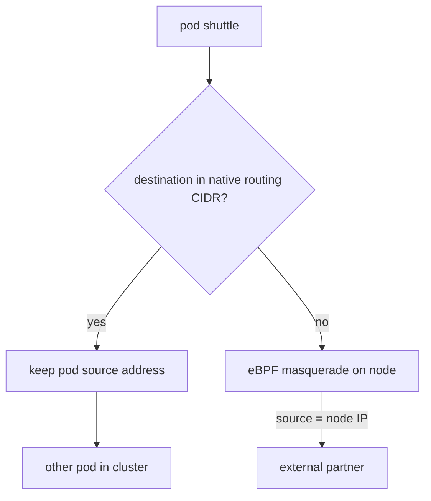

# The Egress Path And Masquerading

A pod receives an address from the pod network, for example `10.244.1.17`. That address is only valid inside the cluster. A server outside the cluster has no route to it, so it could never send a reply to it. Something must change the source address of every packet that leaves the cluster. This part shows which component does that, when it does it, and how you can see the result.

## Follow one request

The `shuttle` pod runs `curl`. Before you read the explanation, run the request and look at the answer. First read the address of the partner from the `lab-env` ConfigMap. A ConfigMap is a Kubernetes object that stores small pieces of configuration data as key-value pairs.

<!-- astrona:playground:renew -->

```sh
PARTNER_IP=$(kubectl -n starfleet get configmap lab-env -o jsonpath='{.data.PARTNER_IP}')
echo $PARTNER_IP
```

The command prints an IPv4 address on the Docker network of the cluster. Now send a request to the `/ip` path of the partner from the `shuttle` pod:

```sh
kubectl -n starfleet exec shuttle -- curl -s http://$PARTNER_IP:8080/ip
```

The partner answers with a small JSON document. Its `origin` field holds the source address of the connection as the partner saw it. Compare that address with the address of the `shuttle` pod:

```sh
kubectl -n starfleet get pod shuttle -o wide
```

The two addresses are different. The pod address comes from the pod CIDR (Classless Inter-Domain Routing block) of its node, and the `origin` field shows the address of the node that runs the pod. The packet left the pod with the pod address, and something on the node replaced it before the packet reached the partner. That step is called masquerading.

## What masquerading is

Masquerading is a form of source network address translation (source NAT, or SNAT). The node rewrites the source address of an outgoing packet to its own address. It also remembers the connection in a table. When the reply arrives for that connection, the node rewrites the destination address back to the pod address and delivers the packet to the pod.

Without masquerading the partner would send the reply to `10.244.1.17`. Its network has no route to that address, so the reply would be lost. With masquerading the partner sends the reply to the node, and the node knows which pod to give it to.

## Which component translates

In this cluster the Cilium agent on the node does the translation with eBPF. The setting `bpf.masquerade=true` in the Helm chart turns on this implementation. An eBPF program attached to the network device of the node handles each packet that leaves. The program decides if the destination needs masquerading, looks up or creates the connection entry in an eBPF map, and rewrites the source address.

Cilium has an older way to do the same work. When `bpf.masquerade` is off, Cilium uses iptables rules on the node. The result is the same for the application. The difference is in speed and in features. Some features, such as the egress gateway that a later topic uses, need the eBPF implementation.

The setting `enable-ipv4-masquerade` in the Cilium ConfigMap turns masquerading for IPv4 on or off. It is on by default. You can read the live values with the following command, which filters the ConfigMap of the agent:

```sh
kubectl -n kube-system get configmap cilium-config -o yaml | grep -E 'masquerade|native-routing'
```

Look for `enable-bpf-masquerade`, `enable-ipv4-masquerade` and `ipv4-native-routing-cidr` in the output. The playground sets the last one to `10.244.0.0/16`, the pod network of the cluster.

## Which destinations are translated

Cilium does not translate every packet. Traffic between pods in the cluster keeps the pod addresses, because every node knows the route to every pod. The rule in eBPF mode is: a packet that leaves a pod is masqueraded when its destination is outside the `ipv4-native-routing-cidr` range, except when the destination is another node of the cluster.



The diagram shows that the destination decides: addresses inside the pod range keep the pod address, and addresses outside it get the node address.

A second tool controls the same decision: ip-masq-agent. You enable it with `ipMasqAgent.enabled=true`. It reads a ConfigMap named `ip-masq-agent` in the `kube-system` namespace. The `config` key of that ConfigMap lists `nonMasqueradeCIDRs`. Traffic to those ranges keeps the pod address. This is useful when the external network has routes for the pod addresses, which is the case when the cluster advertises its pod CIDRs with BGP.

## Tunnel mode and native routing

Cilium moves traffic between nodes in one of two ways. In tunnel mode, which is the default, the agent wraps pod-to-pod packets between nodes in VXLAN (Virtual Extensible LAN) packets. The underlay network only sees node addresses. In native routing mode, the packet leaves the node with the pod address, and the network between the nodes must know the route to each pod CIDR.

Egress to an external destination does not use the tunnel in either mode. The packet leaves through the normal network device of the node. The mode matters for one reason: in native routing mode, the external network can be taught the pod CIDR routes, and then masquerading toward that network is optional.

## Reading the translation on the node

You can ask the Cilium agent for the active masquerade configuration and the connection tracking entries. The `cilium-dbg` command is the debugging tool that is built into the agent image.

```sh
kubectl -n kube-system exec ds/cilium -- cilium-dbg status | grep -i masquerad
```

The line shows whether masquerading is `BPF` or `IPTables`, the interfaces it uses, and the address it translates to. The exact text depends on the Cilium version, so read the line on your screen. The agent that `ds/cilium` selects is one of the agents of the cluster, so the node can be a different one from the node of `shuttle`.

To compare two sources, send the same request from the `drifter` pod in the `outpost` namespace:

```sh
kubectl -n outpost exec drifter -- curl -s http://$PARTNER_IP:8080/ip
```

If `drifter` runs on another node than `shuttle`, the `origin` differs. Both pods leave the cluster with the address of their own node. Check with `kubectl get pods -A -o wide` which node runs which pod.

## What the partner can and cannot know

The partner sees one address for all pods of a node. It cannot tell which pod, namespace or application sent the request. If the partner keeps an allowlist of source addresses, it must list every node that could run the client. A pod that Kubernetes moves to another node arrives from another address and is blocked.

This behavior is the reason for the topics that follow. A network policy can limit which destinations a pod may reach. An egress gateway can give selected pods one fixed source address. Both start from the picture of this part: the pod address stays inside the cluster, and the node address is what the outside world sees.

You now know that Cilium translates the source address on the node with eBPF, that destinations inside the native routing range keep the pod address, and that the partner records the node address. The open question is how to limit where a pod can send traffic at all.

## Common pitfalls

> [!WARNING]
> Do not read the `origin` field from a pod on one node and assume it is valid for all pods. Each node has its own address. Do not assume that traffic to every private address is translated: destinations inside `ipv4-native-routing-cidr`, and in eBPF mode other cluster nodes, keep the pod address. Do not change `bpf.masquerade` on a running cluster without restarting the Cilium agents.
