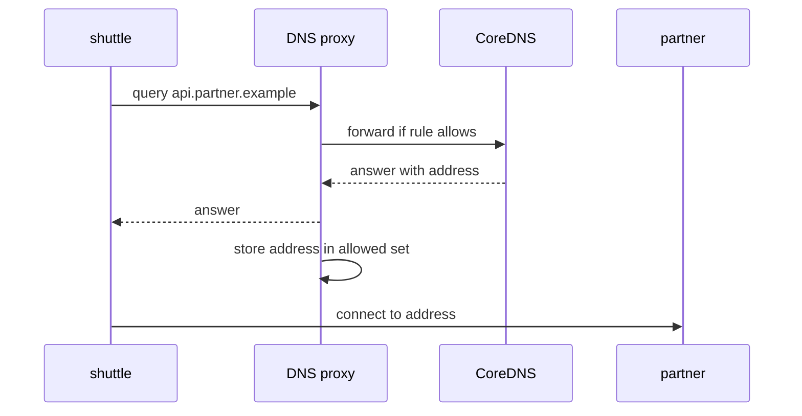

# Controlling Egress With Network Policy

By default every pod can open a connection to any address it can route to. For a pod that handles credentials or talks to a partner, that is too much. If an attacker takes over the pod, the attacker can send data to any server. A network policy limits the destinations. This part builds a policy step by step: deny all egress, allow DNS, and allow one external address.

## Egress rules in a CiliumNetworkPolicy

A `CiliumNetworkPolicy` is a Cilium resource (API group `cilium.io/v2`) that selects pods with an `endpointSelector` and lists what those pods may send (`egress`) or receive (`ingress`). The Cilium agent on each node compiles the policy into eBPF maps. The eBPF program on the network interface of the pod checks every new connection against the maps.

Two behaviors matter before you write the first rule. First, a pod that no policy selects accepts all traffic. Second, as soon as one policy with an `egress` section selects a pod, the pod may send only what the rules allow. All other egress is dropped. Allow rules only add permissions. Cilium also has explicit deny rules (`egressDeny`), which take precedence over every allow rule. The last part of this module covers them.

## Step 1: deny all egress for one pod

Save this as `cnp-shuttle-deny-egress.yaml`:

```yaml
apiVersion: cilium.io/v2
kind: CiliumNetworkPolicy
metadata:
  name: shuttle-egress
  namespace: starfleet
spec:
  endpointSelector:
    matchLabels:
      app: shuttle
  egress:
  - {}
```

An empty rule `- {}` selects no destination. Its presence switches the pod to default deny for egress. Apply it:

<!-- astrona:playground:renew -->

```sh
kubectl apply -f cnp-shuttle-deny-egress.yaml
```

Then check the result. The request to the partner now fails, while the request from `drifter` still works because no policy selects it:

```sh
PARTNER_IP=$(kubectl -n starfleet get configmap lab-env -o jsonpath='{.data.PARTNER_IP}')
kubectl -n starfleet exec shuttle -- curl -s --max-time 5 http://$PARTNER_IP:8080/ip
kubectl -n outpost exec drifter -- curl -s --max-time 5 http://$PARTNER_IP:8080/ip
```

The first command ends without a response after five seconds, and `curl` returns a non-zero exit status. The second one prints the JSON document. The drop happened on the node of `shuttle`, in the eBPF program of the pod. The partner never saw a packet.

## Step 2: allow DNS

An application does not use addresses; it uses names. Name resolution is a request to the DNS (Domain Name System) service of the cluster, CoreDNS, which runs as pods labeled `k8s-app: kube-dns` in `kube-system`. With default deny egress, the `shuttle` pod cannot even resolve a name. Test it with the Service name `probe`:

```sh
kubectl -n starfleet exec shuttle -- curl -s --max-time 5 http://probe/ip
```

The command fails with a name resolution error, not with a connection error. `curl` reports that it could not resolve the host. Allow DNS with a rule that selects the CoreDNS pods and port 53. Save this as `cnp-shuttle-egress.yaml`:

```yaml
apiVersion: cilium.io/v2
kind: CiliumNetworkPolicy
metadata:
  name: shuttle-egress
  namespace: starfleet
spec:
  endpointSelector:
    matchLabels:
      app: shuttle
  egress:
  - toEndpoints:
    - matchLabels:
        "k8s:io.kubernetes.pod.namespace": kube-system
        "k8s:k8s-app": kube-dns
    toPorts:
    - ports:
      - port: "53"
        protocol: ANY
      rules:
        dns:
        - matchPattern: "*"
```

The `toEndpoints` selector names the CoreDNS pods by label. The `rules.dns` section changes how Cilium handles the traffic: instead of forwarding port 53 packets directly, the agent redirects them to its own DNS proxy. The proxy reads each query, checks the name against the pattern `*`, and forwards allowed queries. This is the same proxy that `toFQDNs` rules need later.

Apply the file. Because the object name is `shuttle-egress`, the apply replaces the first policy:

```sh
kubectl apply -f cnp-shuttle-egress.yaml
```

Then check the result. The name `probe` resolves, but the connection to the `probe` Service still fails, because no rule allows traffic to the `probe` pods:

```sh
kubectl -n starfleet exec shuttle -- curl -s --max-time 5 http://probe/ip
```

## Step 3: allow one external address

The partner has an IP address, so a CIDR rule fits. `toCIDR` lists destination prefixes outside the cluster. A single address is a `/32` prefix. Save this as `cnp-shuttle-egress-partner.yaml`. Replace `<PARTNER>` with the value of `$PARTNER_IP` before you save:

```yaml
apiVersion: cilium.io/v2
kind: CiliumNetworkPolicy
metadata:
  name: shuttle-egress
  namespace: starfleet
spec:
  endpointSelector:
    matchLabels:
      app: shuttle
  egress:
  - toEndpoints:
    - matchLabels:
        "k8s:io.kubernetes.pod.namespace": kube-system
        "k8s:k8s-app": kube-dns
    toPorts:
    - ports:
      - port: "53"
        protocol: ANY
      rules:
        dns:
        - matchPattern: "*"
  - toCIDR:
    - <PARTNER>/32
    toPorts:
    - ports:
      - port: "8080"
        protocol: TCP
```

Apply it and test again:

```sh
kubectl apply -f cnp-shuttle-egress-partner.yaml
kubectl -n starfleet exec shuttle -- curl -s --max-time 5 http://$PARTNER_IP:8080/ip
```

The response arrives. A request to any other external address still fails. A policy rule matches the real destination address of the packet, before masquerading. The rule says nothing about the source address that the partner sees.

## CIDR rules and exceptions

A broader external range uses `toCIDRSet` with a `cidr` and an optional `except` list. For example, a rule can allow a `/16` and exclude one `/24` inside it. Use `toCIDR` for exact prefixes and `toCIDRSet` when you need exceptions. Remember that `toCIDR` rules apply to destinations outside the cluster. Traffic to pods and nodes is matched by identity, with `toEndpoints`, `toEntities` or `toServices`, not by CIDR.

## Name-based rules with toFQDNs

Partners change their addresses. A rule with `toFQDNs` allows a name instead of an address:

```yaml
  - toFQDNs:
    - matchName: "api.partner.example"
    toPorts:
    - ports:
      - port: "443"
        protocol: TCP
```

A `matchPattern` such as `*.partner.example` matches names with one or more subdomain labels. It does not match `partner.example` itself. The rule only works together with the DNS rule from step 2. The reason is the mechanism.

The Cilium DNS proxy sees every DNS response that goes to the pod. When a response answers a name that a `toFQDNs` rule allows, the agent stores the returned addresses with their time to live (TTL) in a cache and adds them to the eBPF maps as allowed destinations. When the TTL expires, the addresses leave the maps. The pod may connect only to an address that it learned through a DNS answer that the proxy saw.

This has two consequences. A pod that connects to a hardcoded IP address of the partner without a lookup is blocked. A pod that resolves the name through another resolver, which bypasses the proxy, is also blocked. Make sure the application uses the cluster DNS.



The sequence shows that the allowed address comes from the proxy cache: the connection is allowed because the proxy saw the answer first.

## What you can now do

You can switch a pod to default deny egress, allow cluster DNS with the DNS proxy rule, allow an external address with `toCIDR`, and allow a name with `toFQDNs`. The next question is what happens when the policy is correct and the connection still fails, because the source address or the return path is wrong.

## Common pitfalls

> [!WARNING]
> A policy with only a `toCIDR` rule blocks DNS, so the application fails at name resolution first. A `toFQDNs` rule without the DNS rule never allows any address. `toCIDR` does not match cluster pods or nodes. An application that caches a resolved address for longer than the DNS TTL can connect to an address that the agent has already removed.
