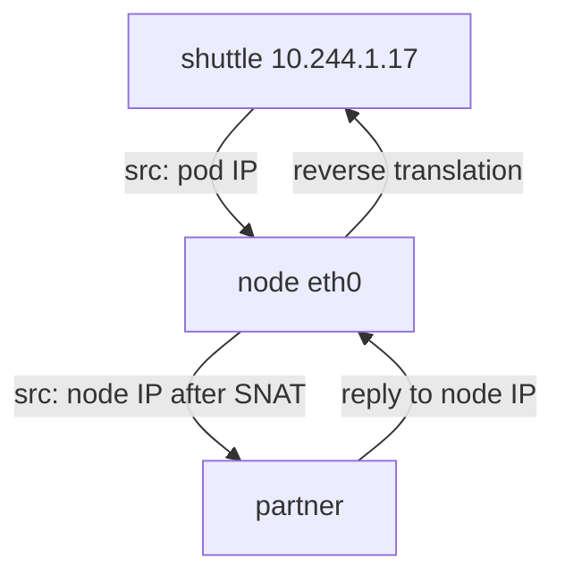

# Source Identity And Return Paths

A connection has two directions. The request goes from the pod to the partner. The reply goes from the partner back to the pod. A policy that allows the request does not make the reply arrive. This part explains who the partner thinks is calling, what the external side must know to answer, and how to find the failing stage when an outbound connection does not work.

## The source identity the partner sees

The partner knows only what is in the packet: a source IP address, a source port, and the content of the application protocol. After masquerading, the source IP address is the address of the node. Three things follow for anyone who operates the external service.

First, an allowlist on the partner must contain node addresses, not pod addresses. Pod addresses are temporary. Kubernetes assigns a new one every time a pod is created. Second, the partner cannot separate the workloads that share a node. Any pod on the node that the policy allows to reach the partner arrives from the same address. Third, the address changes when Kubernetes moves the workload to another node, because each node has its own address.

Look at this with the playground. Send a request from `shuttle` and from `drifter` and compare the `origin` values with the node addresses:

<!-- astrona:playground:renew -->

```sh
PARTNER_IP=$(kubectl -n starfleet get configmap lab-env -o jsonpath='{.data.PARTNER_IP}')
kubectl get nodes -o wide
kubectl -n starfleet exec shuttle -- curl -s http://$PARTNER_IP:8080/ip
```

The `INTERNAL-IP` column of the first command lists the addresses of the three nodes. The `origin` value of the second command is equal to one of them. If the policy from the previous topic is still applied, the request is allowed because the rule matches the destination `<PARTNER>/32` on port 8080.

A workload that a controller recreates can land on another node, and then its source address changes. The `probe` Deployment shows this. Note its node, delete its pod so the Deployment creates a new one, and note the node again:

```sh
kubectl -n starfleet get pods -l app=probe -o wide
kubectl -n starfleet delete pod -l app=probe
kubectl -n starfleet get pods -l app=probe -o wide
```

The scheduler (the Kubernetes component that chooses a node for each new pod) may pick the same node or a different one. When it picks a different node, the pod address and the node address both change. An external allowlist that lists only the first node then blocks the new pod.

## The return path

When the partner answers, it sends the reply to the source address of the request. With masquerading that address is the node. The reply reaches the node, because the node address is routable on the Docker network. The Cilium agent finds the connection in the translation table, rewrites the destination address to the pod address, and the packet goes to the pod.

Without masquerading, the partner would send the reply to the pod address. That works only if the external network has a route to the pod CIDR. A route has a destination prefix and a next hop. In this cluster each node owns one pod prefix, for example `10.244.1.0/24`. The next hop for that prefix is the address of the node. The partner would need a route for every node prefix.



The diagram shows the two directions: the node changes the source address on the way out and changes the destination address back on the way in.

Two designs avoid the translation. In the first, you add static routes on the external router for every node prefix. In the second, the nodes announce their pod prefixes to the router with BGP (Border Gateway Protocol). Both require that you also tell Cilium not to masquerade toward that network. You do that with `ipv4NativeRoutingCIDR` or with the ip-masq-agent list `nonMasqueradeCIDRs`. If you set only one half, traffic breaks: the pods send packets with their own addresses and the network cannot answer, or the network has routes but Cilium still translates.

## Stateful devices and connection tracking

Firewalls on the path remember connections. A stateful firewall allows the reply only if it saw the request in the other direction. If the request leaves through one device and the reply arrives through another, the second device drops it. When the source address changes between node addresses, the firewall rules must allow all of them. Connection tracking on the node also has a limit: the eBPF map of tracked connections has a fixed size, and when it fills up, new connections are refused.

## Diagnosing a failed outbound connection

A systematic order finds the failing stage faster than guessing. Work from the pod outward and test each stage by itself.

1. Name resolution. Run `kubectl exec` with `nslookup` or `curl` against a name. A "could not resolve host" error means the DNS rule or CoreDNS is the problem.
2. Policy. If the name resolves but the connection hangs, check whether a policy selects the pod. Run `kubectl get cnp -A` and read the `egress` rules.
3. Drops. Use Hubble or the agent monitor to see the verdict of the connection. Hubble is the observability layer of Cilium. With the Hubble CLI the filter `--verdict DROPPED` lists denied flows and shows the reason. Without the CLI, `kubectl -n kube-system exec ds/cilium -- cilium-dbg monitor --type drop` prints drop events from the node of that agent.
4. Source address. Ask the partner what it sees, as you did with `/ip`. If the address is not on its allowlist, the partner closes the connection even though the network path is fine.
5. Return path. If the partner logs the request but the pod gets no answer, look for a missing route or a firewall on the way back.

Use `cilium-dbg monitor` on the agent of the node that runs the pod. The agent that `ds/cilium` selects may run on another node. Find the agent pod of the node with `kubectl -n kube-system get pods -l k8s-app=cilium -o wide`, then run the command with `kubectl exec` against that pod name.

## Reading dropped flows with Hubble

Hubble is the observability component of Cilium. Each agent records the verdict of every flow that its eBPF programs see. A flow is one connection attempt, with source, destination, port and the verdict: forwarded, dropped, or denied by policy. Hubble Relay collects the flows of all agents, so one command can show the flows of the whole cluster.

The playground enables Hubble Relay. When the Hubble command-line client is installed on your machine, it reads the flows through the relay. Filter by namespace and verdict to see only the denied connections of the `starfleet` namespace. The output lists the source pod, the destination address and port, and the reason for the drop. When the reason is a policy verdict, the fix belongs in a policy. When flows are forwarded but the pod still gets no reply, the problem is on the return path.

## A worked case

The `shuttle` pod gets no response from the partner. The name resolves, the policy has a `toCIDR` rule for the right address, and `/ip` called from `drifter` works. The difference between the two pods is the policy only. The drop monitor shows a policy denied event for the destination port 8080 of the partner. The policy says port 8081 by mistake. The fix is a one-character change in the rule, not a change of routes or of the partner.

A second case: the connection is allowed by policy and visible in the partner log, but the partner replies with an HTTP 403. The partner checks the source address against its allowlist and the node address is missing. The fix is on the partner side, or the pod must leave from a controlled address, which needs a gateway.

## What you can now do

You can say which address the partner sees, explain why the reply needs a route to the node or to the pod, and test each stage of an outbound connection separately. The open question is what to do when the partner requires one fixed source address that does not change when pods move.

## Common pitfalls

> [!WARNING]
> Do not add the pod address to an external allowlist. Do not disable masquerading without proof that the external network has routes for every pod prefix. Do not test only with `curl` from your laptop: the path from a pod differs. A request that works from `drifter` and fails from `shuttle` points to policy, not to the network.
