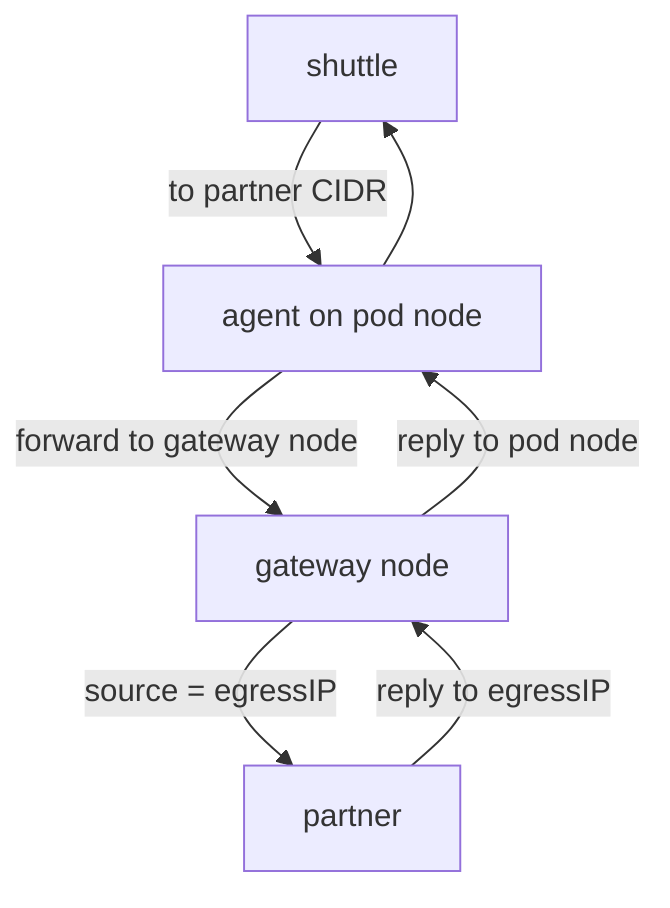

# Why A Fixed Source Address Matters

An external partner often accepts requests only from a short list of source addresses. The partner keeps that list in a firewall, in an API gateway, or in the settings of its own account. When a workload in a Kubernetes cluster calls such a partner, the source address of the request decides if the partner answers or refuses. This part explains why the default behavior of the cluster does not fit that need and which Cilium feature solves it.

## The problem with node addresses

When a pod sends a request to an address outside the cluster, the Cilium agent on the node replaces the source address of the packet with the address of the node. This step is called masquerading. The partner therefore sees the address of the node that runs the pod, not the address of the pod.

A cluster has several nodes, and Kubernetes can start a pod on any of them. A pod that is deleted and recreated can land on another node, and then the partner sees another source address. An allowlist at the partner must hold the address of every node that could ever run the pod. When the cluster adds a node or replaces one, the allowlist at the partner is out of date, and the requests are refused.

Three facts follow for the team that runs the partner:

- The allowlist grows with the number of nodes, not with the number of clients.
- The partner cannot tell which workload sent a request. All pods on one node arrive from the same address.
- Changes in the cluster cause outages at the partner, and the cluster team does not control the partner.

A fixed address solves all three. The partner lists one address. The cluster decides which pods leave through that address, and which node owns it.

## What the egress gateway is

The egress gateway is a feature of the Cilium agent. It redirects the outgoing traffic of selected pods to one chosen node of the cluster, the gateway node. The gateway node then masquerades the packets with an address that you pick. The partner sees that address for every selected pod, no matter on which node the pod runs.

You configure the feature with the `CiliumEgressGatewayPolicy` resource. A `CiliumEgressGatewayPolicy` is a cluster-wide Cilium resource (API group `cilium.io/v2`, no namespace) with three parts:

- `selectors` choose the pods. A selector matches pod labels, including the label that holds the namespace.
- `destinationCIDRs` list the external destinations that the policy applies to. Traffic to other destinations is not affected.
- `egressGateway` names the gateway node with a `nodeSelector` and the source address with `egressIP`.

The feature needs eBPF masquerading and the replacement of kube-proxy. Cilium refuses to start the feature without them. In the playground of this module the Helm values `egressGateway.enabled=true`, `bpf.masquerade=true` and `kubeProxyReplacement=true` are set for that reason.

## The path of a packet with a gateway policy

Take the `shuttle` pod in `starfleet`. A policy selects it for the destination of the partner. The pod runs on one worker node, and the gateway node is the other worker node.



The diagram shows the two extra hops: the packet goes to the gateway node first, and the reply comes back through the same node.

The steps in words:

1. The eBPF program on the node of `shuttle` looks at each new connection. It checks the source pod and the destination against the policy maps that the agent compiled from all gateway policies.
2. When a policy matches, the program does not send the packet to the network of the node. It sends the packet to the gateway node, inside the Cilium tunnel or over the native route between nodes.
3. The eBPF program on the gateway node masquerades the packet. The source address becomes the `egressIP` of the policy.
4. The partner answers to the `egressIP`. The gateway node finds the connection in its table and sends the reply back to the node of the pod.

Which component does what: the operator and the agent read the policy resource, the agent of each node compiles it into eBPF maps, and the eBPF programs move the packets. The `egressIP` must belong to the gateway node, because the reply has to arrive there.

## Where the egress address comes from

The `egressIP` field is optional in the resource. When you leave it out, the gateway node uses the first IPv4 address of the interface that it uses to reach the destination. That is the normal node address. You use `egressIP` when you want a different, dedicated address.

A dedicated address must be added to the interface of the gateway node by something outside Cilium: a cloud provider, a configuration management tool, or an administrator. Cilium does not create the address. If the address is missing on the node, the packets leave with a source address that the node cannot receive replies for, and the connection hangs.

In the playground the setup adds the secondary address to the first worker node. The ConfigMap `lab-env` in `starfleet` holds the address in the key `GATEWAY_IP` and the node name in `GATEWAY_NODE`. Read them with:

<!-- astrona:playground:renew -->

```sh
kubectl -n starfleet get configmap lab-env -o jsonpath='{.data.GATEWAY_IP}'
kubectl -n starfleet get configmap lab-env -o jsonpath='{.data.GATEWAY_NODE}'
```

Both commands print one value each. The first value is an IPv4 address on the Docker network of the cluster. The second value is the name of a worker node, which you can also find in `kubectl get nodes`.

## What stays the same

A gateway policy changes only the path and the source address of selected traffic. Three things stay as they were:

- Traffic from the selected pods to destinations outside `destinationCIDRs` keeps the normal path and the node address.
- Traffic to other pods and nodes of the cluster is not affected, because those destinations are not external.
- A `CiliumNetworkPolicy` still decides which destinations the pod may reach. A gateway policy does not allow anything.

Remember the last point. A pod that a default deny policy blocks stays blocked, even when a gateway policy selects it. The two resources answer two different questions: policy asks whether the traffic is allowed, and the gateway policy asks which address it leaves from.

## What you can now do

You can explain why node addresses do not work for an allowlist, describe the three parts of a `CiliumEgressGatewayPolicy`, and follow a packet through the gateway node. You also know that the address must already exist on the node. The open question is how to write the policy and how to prove that the partner sees the fixed address.

## Common pitfalls

> [!WARNING]
> Do not expect Cilium to create the egress address on the node. Do not use a gateway policy to allow traffic: it only chooses the path. Do not enable the feature without eBPF masquerading and kube-proxy replacement. Do not select pods by a label that exists in several namespaces without also matching the namespace label.
