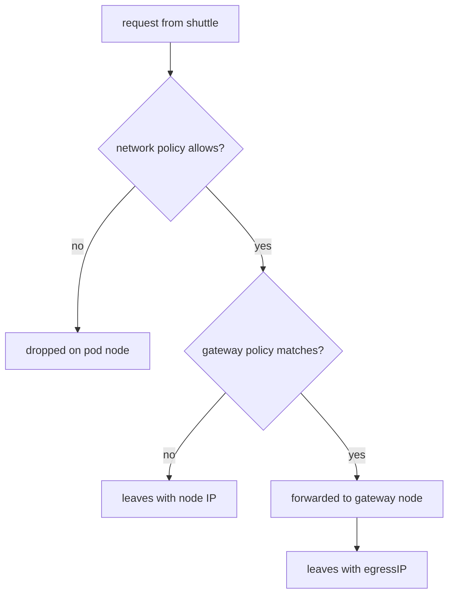

# Gateway Failures And Network Policy

A gateway policy adds a dependency: the traffic of the selected pods now relies on one node and one address. This part covers what that costs, how a `CiliumNetworkPolicy` combines with a gateway policy, and how to find the cause when a selected pod cannot reach its partner. Operators meet these cases in production, and they appear in exam scenarios.

## One node carries the traffic

All selected traffic passes the gateway node. Three limits follow from this design.

- Capacity. The node must handle the bandwidth and the connection count of all selected pods, in addition to its own workloads.
- Availability. When the gateway node is down, the selected pods cannot reach the destinations in `destinationCIDRs`. The policy has no automatic switch to a second node in its basic form.
- Maintenance. Draining the gateway node for an upgrade interrupts the connections that use it.

The remedies are operational. Choose a node that is dedicated to the gateway role and label it. Select the gateway by that label instead of by the host name, so that the label can move to a replacement node. Keep the dedicated address movable, so that the replacement node can take it over. Test the failover procedure before an incident, not during one.

A selector by role label looks like this. Save it as `egress-gateway-role.yaml`. The label `egress-role=gateway` is not set by Kubernetes: you must add it to a node first.

```yaml
apiVersion: cilium.io/v2
kind: CiliumEgressGatewayPolicy
metadata:
  name: shuttle-to-partner-by-role
spec:
  selectors:
  - podSelector:
      matchLabels:
        io.kubernetes.pod.namespace: starfleet
        app: shuttle
  destinationCIDRs:
  - <PARTNER>/32
  egressGateway:
    nodeSelector:
      matchLabels:
        egress-role: gateway
    egressIP: <GATEWAY>
```

The selector now matches any node with the label. Make sure that exactly one node has the label at a time.

## The network policy still applies

A gateway policy does not allow traffic. A pod that a `CiliumNetworkPolicy` puts in default deny stays denied until a rule allows the destination. For `shuttle`, a working combination has two resources:

- A `CiliumNetworkPolicy` in `starfleet` with a DNS rule and a `toCIDR` rule for `<PARTNER>/32`.
- A `CiliumEgressGatewayPolicy` for the same pod and destination.

The network policy matches the real destination address, the partner. It says nothing about the source address. The gateway policy changes the source address and says nothing about permissions. If you remove one of them, you lose one property: without the network policy, the pod can reach any destination; without the gateway policy, the partner sees the node address.

<!-- astrona:playground:renew -->

Check the two properties separately in the playground. First check the permission. Apply a policy that denies all egress of `shuttle` with the empty rule `- {}` and run `curl` against the partner. The request fails even though the gateway policy exists. Then add the allow rules and run the same request again. The answer returns, and its `origin` is the gateway address.

## Diagnosing a pod that cannot reach the partner

Work from the pod outward, as for any outbound failure, and add the gateway as one more stage.

1. Does the pod resolve names and pass the network policy? If a request to an address that the network policy allows fails, look at the policy first. Use `cilium-dbg monitor --type drop` on the node of the pod to see policy drops.
2. Is the pod selected? `kubectl get pod shuttle -n starfleet --show-labels` lists the labels. Compare them with `selectors`. A label that does not match leaves the pod on the normal path: the request works, but with the node address.
3. Does the destination match? A request to an address outside `destinationCIDRs` also leaves with the node address.
4. Does the gateway node exist? Run `kubectl get nodes --show-labels` and check that the `nodeSelector` matches one node.
5. Does the node own the address? `docker exec <node container> ip addr show eth0` for a `kind` node, or `ip addr` on a real node, lists the addresses. The `egressIP` must be in the list.
6. Does the reply return? If the partner logs the request with the right source address and the pod gets no answer, the reply path to the gateway node is broken. Check routes and firewalls for the egress address.

The symptoms differ by stage. A wrong selector gives a successful request with the wrong `origin`. A missing node or a missing address gives a request that hangs. A policy drop gives a request that hangs and a drop event in the monitor. Read the symptom before you change anything.

## Stages at a glance



The diagram shows that the network policy decides first and the gateway policy second.

## Several policies and overlaps

More than one gateway policy can exist. Give each policy its own destination and pod selector. If two policies match the same pod and the same destination, the result is not something to rely on, so avoid overlaps. A clean design has one policy per partner and one dedicated address per group of pods.

A different team may need its own address. Create a second policy that selects that team's namespace and names another `egressIP`. The partner then sees two addresses and can allow them separately.

## What you can now do

You can name the limits of a single gateway node, select the gateway by role, combine a gateway policy with a `CiliumNetworkPolicy`, and test the stages in order. You can read a symptom and tell if it points to the selector, the node, the address or the policy.

## Common pitfalls

> [!WARNING]
> A request that works with the wrong `origin` means the gateway policy did not match: check labels and destination. A request that hangs points to the node, the address, a network policy drop, or the return path. Do not label two nodes as the gateway. Do not remove the network policy because the gateway policy exists: it does not allow traffic.
