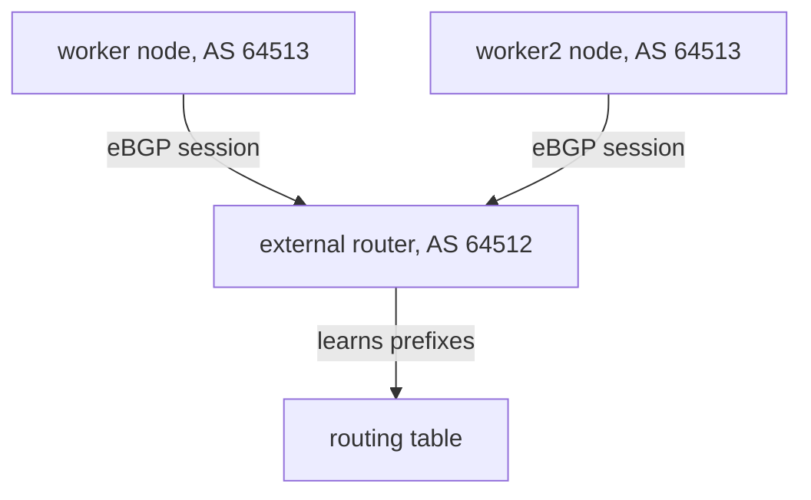

# BGP For Kubernetes Engineers

A cluster network works well while every client lives inside the cluster. Problems start when a system outside the cluster must reach a pod or a Service, because the external network has no routes for cluster addresses. BGP (Border Gateway Protocol) is the protocol that routers use to tell each other which address ranges they can reach. This part explains the parts of BGP that matter when Cilium takes the role of a router.

## What BGP does

BGP is a routing protocol. Two routers open a TCP connection on port 179 and exchange messages. Each router tells the other which prefixes it can reach. A prefix is a block of addresses written as an address and a length, for example `10.244.1.0/24`. Each router adds the prefixes that it learned to its routing table and sends packets for those prefixes to the router that announced them.

Three terms appear in every BGP configuration.

- Autonomous system (AS): a group of routers under one administration. Each AS has a number, the AS number (ASN). A private ASN is in the range 64512 to 65534.
- Peer: the router at the other end of a BGP connection. The connection is a session.
- Advertisement: a message that announces a prefix to a peer.

A session between two routers with different ASNs is an eBGP session (external BGP). A session between two routers with the same ASN is an iBGP session (internal BGP). In this module the cluster nodes use ASN 64513 and the external router uses ASN 64512, so every session is an eBGP session.

## The session and its states

A session moves through states. The state tells you how far the setup got, so it is the first thing you read when peering fails.

| State | Meaning |
| --- | --- |
| Idle | No connection attempt is active |
| Connect | The router tries to open the TCP connection |
| Active | The TCP connection failed, and the router waits to retry |
| OpenSent | The TCP connection works and the router sent an OPEN message |
| OpenConfirm | The router received a valid OPEN message from the peer |
| Established | Both sides agreed, and they now exchange prefixes |

The OPEN message carries the ASN, the hold time and the router identifier. The routers compare them. If the ASN in the OPEN message differs from the ASN that the receiver expects for this peer, the receiver sends a notification and closes the session. That is the most common mistake in a new setup.

## Timers

Two timers keep a session alive. The keepalive timer sets how often a router sends a small keepalive message. The hold timer sets how long a router waits for any message before it declares the peer dead and drops all prefixes learned from it. The usual defaults are 30 seconds for keepalive and 90 seconds for hold time, which means a failed link is noticed after up to 90 seconds. Both sides negotiate the lower hold time of the two. Shorter timers detect failures faster, but they put more load on the routers and can drop a session during a short pause of the agent.

## Why a cluster node speaks BGP

A Kubernetes node can run a BGP speaker. The speaker announces the prefixes that belong to the node, such as its pod prefix, or the addresses of Services. The external router learns them and can send traffic for those addresses to the node. Without BGP, an administrator would add a static route for every node and update it whenever a node changes.

The diagram shows two nodes that each open a session to the router. The router collects the prefixes of both nodes in its routing table.

## Passive and active speakers

Every session has an initiator. The side that opens the TCP connection is active, and the side that waits for a connection is passive. Both sides can try to connect, and BGP resolves the collision. In the playground of this module the external router listens for connections from the whole address range of the Docker network, and the Cilium nodes open the connections. The nodes do not listen on port 179 unless you configure a local port.

## Direct connection and TTL

An eBGP session is expected between directly connected routers. The sender sets the IP TTL (time to live) of the packets to 1, so a packet cannot pass a router in between. When the peer is several hops away, you must raise the TTL. The setting is called eBGP multihop. In the playground, the nodes and the router sit on the same Docker network, so the default works.

## What an advertisement carries

An advertisement is not only a prefix. It carries path attributes. Four of them matter here.

- NEXT_HOP: the address that the receiver must use to reach the prefix. For a node that announces its own prefix, the next hop is the address of the node.
- AS_PATH: the list of ASNs that the advertisement passed. A router that sees its own ASN in the list drops the advertisement, which prevents loops.
- LOCAL_PREF: a number that a router in the same AS uses to prefer one path over another. A higher value wins. It is sent only inside one AS.
- COMMUNITY: a tag that the receiver can match in its own rules, for example to decide how far to spread a prefix.

When a router learns the same prefix from more than one peer, it picks one path by a fixed list of rules. The shorter AS path wins when the earlier rules tie. If equal paths exist and the router allows multipath, it can use several next hops at once. That is how a router can spread traffic across two nodes that announce the same Service address.

## Withdrawal

A router can also withdraw a prefix: it tells the peer that the prefix is no longer reachable. The peer removes it from its table. The same happens when a session drops: the router discards every prefix that it learned over that session. This is the reason that a node failure removes its routes after the hold time passes. It is also the reason that an agent restart can remove routes for a short time unless graceful restart is on.

## Reading a routing table

A router shows what it learned. On an FRR router, the command `show bgp summary` lists each peer with its state and the number of prefixes received, and `show ip route bgp` lists the routes that BGP installed. A peer in the state `Established` has a number in the prefix column. A peer in any other state has the state name in that column. This is the same information that the Cilium tools show from the node side, so you can check a session from both ends.

A prefix received is not yet a prefix used. The router applies its own rules first: inbound filters, path selection and a check that the next hop is reachable. If the next hop is not reachable, the router keeps the prefix in the BGP table but does not install a route.

## What you can now do

You can describe what a BGP session is, name the states and read where a session is stuck, explain ASN and the difference between eBGP and iBGP, and explain the two timers. The open question is how Cilium represents all of this in Kubernetes resources.

## Common pitfalls

> [!WARNING]
> A session that stays in Active usually means the TCP connection fails: wrong peer address, a firewall, or no listener. A session that drops after OpenSent points to a mismatch in ASN. BGP learns prefixes only after the state is Established. Do not shorten the hold time below the values that the software supports.
