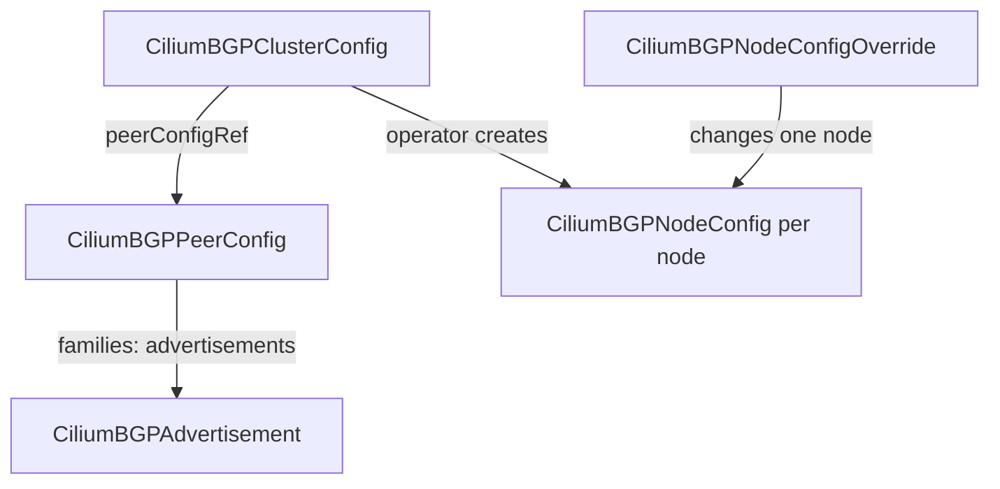

# The Cilium BGP Resources

Cilium runs a BGP speaker inside its agent on each node that you select. You do not configure the speaker with a file on the node. You describe the wanted peering in Kubernetes resources, and Cilium turns them into a speaker per node. This part explains the feature switch, the three resources that you write, and the resource that Cilium writes for you.

## Turning the feature on

The BGP Control Plane is off by default. The Helm value `bgpControlPlane.enabled=true` turns it on. The Cilium operator then watches the BGP resources, and the agents start a BGP speaker on the nodes that a configuration selects. The playground sets the value at installation. You can check it in the agent configuration:

<!-- astrona:playground:renew -->

```sh
kubectl -n kube-system get configmap cilium-config -o yaml | grep -i bgp
kubectl get crd | grep -i ciliumbgp
```

The first command shows the setting `enable-bgp-control-plane`. The second command lists the custom resource definitions (CRDs) that the feature added, including `ciliumbgpclusterconfigs`, `ciliumbgppeerconfigs`, `ciliumbgpadvertisements`, `ciliumbgpnodeconfigs` and `ciliumbgpnodeconfigoverrides`.

## The four resources

The configuration is split into resources so that you can reuse each part for many nodes and peers.

- `CiliumBGPClusterConfig`: which nodes run BGP, with which local ASN, and which peers they connect to.
- `CiliumBGPPeerConfig`: the settings of a session, such as timers and the address families. One peer config can serve many peers.
- `CiliumBGPAdvertisement`: which prefixes to announce.
- `CiliumBGPNodeConfigOverride`: settings for one node that differ from the cluster-wide ones, such as the router identifier.

A fifth resource, `CiliumBGPNodeConfig`, is not written by you. The operator creates one per selected node from the cluster configuration, and it shows the state of the sessions of that node.



The diagram shows the links: the cluster configuration points to the peer configuration, the peer configuration selects advertisements by label, and the operator derives the node configurations.

## The cluster configuration

A `CiliumBGPClusterConfig` has a `nodeSelector` and a list of `bgpInstances`. Each instance is one BGP router process inside the agent. It has a name, a `localASN` and a list of `peers`. Each peer has a name, the `peerASN`, the `peerAddress` and a `peerConfigRef` that names a peer configuration.

The `nodeSelector` matters most. Only nodes with matching labels run the instance. If the selector matches no node, nothing happens, and the status of the cluster configuration shows the condition `cilium.io/NoMatchingNode`. If two cluster configurations select the same node, the condition `cilium.io/ConflictingClusterConfig` appears. A node must belong to one cluster configuration only.

Omitting `localPort` makes the speaker outbound-only: it opens connections but does not listen. That fits a peer that listens, such as the router in the playground. Setting `localPort: 179` makes the node listen as well. The listener on port 179 needs the capability `CAP_NET_BIND_SERVICE` for the agent, which the Helm value `securityContext.capabilities.ciliumAgent` grants.

## The peer configuration

A `CiliumBGPPeerConfig` holds what is shared between sessions.

- `timers` has `connectRetryTimeSeconds`, `holdTimeSeconds` and `keepAliveTimeSeconds`. The defaults are 120, 90 and 30. The minimum hold time is 3 seconds and the minimum keepalive is 1 second.
- `ebgpMultihop` raises the TTL when the peer is not directly connected.
- `gracefulRestart` keeps the routes at the peer while the agent restarts.
- `authSecretRef` names a Secret with a key `password` for MD5 authentication of the session. The Secret lives in the namespace that the Helm value `bgpControlPlane.secretNamespace.name` sets, by default `kube-system`.
- `transport` has the peer port and the source interface.
- `families` lists the address families that the session carries. Each family has an `afi` such as `ipv4`, a `safi` such as `unicast`, and an `advertisements` selector with `matchLabels`.

The `families` list controls what Cilium sends. The selector picks `CiliumBGPAdvertisement` resources by their labels. Without a matching advertisement, the session comes up but no prefix is sent.

## The node configuration and overrides

The operator writes the `CiliumBGPNodeConfig` for each selected node. Its status is the place to read the result: for each instance and each peer it lists the peering state, the time when the session was established, the applied timers and the number of routes in each direction. Read it with `kubectl get ciliumbgpnodeconfigs` and `kubectl describe ciliumbgpnodeconfigs <node>`.

A `CiliumBGPNodeConfigOverride` changes one node. Its name must equal the node name. It can set the `routerID`, a `localPort`, a `localASN` or a `localAddress` for a peer. Use it only for the node that needs a difference. For example, a node with two network interfaces might need a specific `localAddress` so that the session leaves from the interface that the router knows.

## Which component does what

The work is split between two components. The Cilium operator reads the `CiliumBGPClusterConfig`, finds the nodes that match the selector and writes one `CiliumBGPNodeConfig` for each of them. It also writes the status of the cluster configuration and of the peer configuration.

The Cilium agent on a selected node reads its own `CiliumBGPNodeConfig`. It starts a BGP speaker inside the agent process (the speaker is built on the GoBGP library), opens the sessions and sends the advertised prefixes. The agent also writes the session state back to the status of the node configuration.

This split explains two behaviors. When you change the cluster configuration, the operator updates the node configurations first, and the agents follow a moment later. When an agent restarts, its sessions drop, and the routes disappear at the peer until the sessions are back, unless graceful restart is on.

## Names that must match

Several names must agree for the configuration to work.

- The `peerConfigRef.name` in the cluster configuration must equal the `metadata.name` of a peer configuration.
- The `matchLabels` in a family of the peer configuration must match the labels of an advertisement.
- The `peerASN` must equal the ASN that the router configured for the cluster nodes. The `localASN` must equal the ASN that the router expects.
- In an override, the resource name must equal a node name, and the instance and peer names must equal those of the cluster configuration.

A single mismatch leads to a quiet failure: Kubernetes accepts every resource, and only the status or the session state shows the problem. Read the conditions in the status before you read logs.

## What you can now do

You can name the four resources and the generated node configuration, tell which one holds nodes, peers, session settings and advertisements, and explain why a node label controls where BGP runs. The open question is how to put them together and prove the session works.

## Common pitfalls

> [!WARNING]
> Without `bgpControlPlane.enabled=true` the resources have no effect. A label on the node must match the `nodeSelector`, or no speaker starts. Do not select a node by two cluster configurations. A `CiliumBGPPeerConfig` that does not exist makes the condition `cilium.io/MissingPeerConfigs` appear. A password secret that does not exist leads to a session with an empty password.
