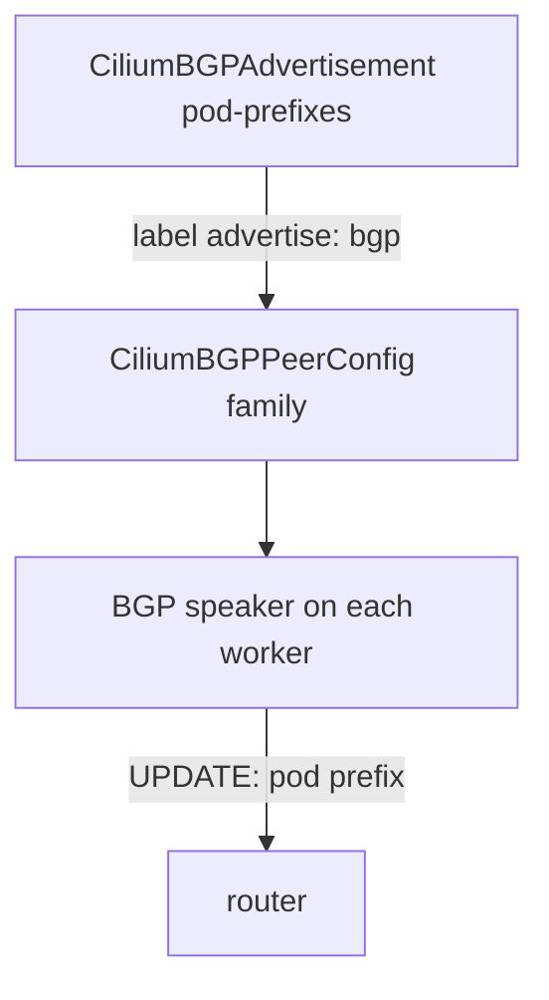

# Advertising Pod And Service Addresses

A BGP session that carries no prefixes does nothing for the network. The router learns a prefix only when the nodes announce it. This part shows what a Cilium node can announce, how the `CiliumBGPAdvertisement` resource selects it, and how to check on the router that the prefixes arrived.

## What a node can announce

Cilium can announce several kinds of addresses. Three matter here. You pick them with the field `advertisementType`.

- `PodCIDR`: the pod prefix of the node, for example `10.244.1.0/24`. The router then has a route to every pod on that node.
- `CiliumPodIPPool`: the prefixes of a Cilium multi-pool pod address pool, for clusters that use that address management mode.
- `Service`: addresses of Services. The field `service.addresses` lists which kind: `LoadBalancerIP`, `ClusterIP` or `ExternalIP`.

The example cluster uses the Kubernetes address management mode, where the Kubernetes controller assigns each node a pod prefix. That is why `PodCIDR` is the right type for pod prefixes here.

## The starting state

The playground already has a working session between the two worker nodes and the external router. The peer configuration has a family `ipv4/unicast` that selects advertisements with the label `advertise: bgp`. No advertisement exists, so the router has learned nothing.

Check this from the router:

<!-- astrona:playground:renew -->

```sh
ROUTER_CONTAINER=$(kubectl -n starfleet get configmap lab-env -o jsonpath='{.data.ROUTER_CONTAINER}')
docker exec $ROUTER_CONTAINER vtysh -c 'show bgp summary'
docker exec $ROUTER_CONTAINER vtysh -c 'show ip route bgp'
```

The first command lists two neighbors, one for each worker, in the state `Established`. The second command prints no BGP routes, because nothing was announced yet.

## Advertise the pod prefixes

Save this as `bgp-advertisement-podcidr.yaml`:

```yaml
apiVersion: cilium.io/v2
kind: CiliumBGPAdvertisement
metadata:
  name: pod-prefixes
  labels:
    advertise: bgp
spec:
  advertisements:
  - advertisementType: PodCIDR
```

The label on the advertisement is what links it to the peer configuration. The family in the peer configuration selects advertisements with `advertise: bgp`. Without that label, the advertisement is valid but nothing selects it.

Apply it:

```sh
kubectl apply -f bgp-advertisement-podcidr.yaml
```

Then check the result on the router:

```sh
docker exec $ROUTER_CONTAINER vtysh -c 'show ip route bgp'
kubectl get nodes -o custom-columns=NAME:.metadata.name,PODCIDR:.spec.podCIDR
```

The router lists one route for the pod prefix of each worker node, and the next hop of each route is the address of that worker. The second command prints the pod prefix of every node. The control plane node has a pod prefix as well, but its prefix is not on the router, because the control plane node does not run a speaker.



The diagram shows the chain: the advertisement is picked by its label, and each speaker sends its own pod prefix to the router.

## Advertise Services

A `Service` advertisement announces the addresses of Services that a selector matches. Use the label of the Service as the selector, and list the address kinds that you want to announce. Save this as `bgp-advertisement-service.yaml`:

```yaml
apiVersion: cilium.io/v2
kind: CiliumBGPAdvertisement
metadata:
  name: service-addresses
  labels:
    advertise: bgp
spec:
  advertisements:
  - advertisementType: Service
    service:
      addresses:
      - LoadBalancerIP
    selector:
      matchExpressions:
      - key: bgp
        operator: In
        values:
        - advertise
```

Apply it:

```sh
kubectl apply -f bgp-advertisement-service.yaml
```

This advertisement announces the `LoadBalancerIP` of every Service that has the label `bgp=advertise`. A Service without the label is not announced. A Service of type `LoadBalancer` gets its address from the load balancer IP address management feature, which the next part covers. Announcing `ClusterIP` or `ExternalIP` addresses works the same way, but the cluster IP of a Service is usually not meant to be reachable from outside, so announce it only when you need that.

## Merged advertisements

Several advertisements can select the same prefixes. The documentation states that Cilium combines them: the communities are the union, and the largest local preference wins. Use separate advertisements for separate jobs, for example one for pod prefixes and one for Services. A separate advertisement for a group of Services can set communities that the router matches in its own rules.

## What you can now do

You can name the advertisement types, write an advertisement for pod prefixes and for Services, connect it to a session with the label, and check on the router that the prefixes arrived. The open question is where a Service address comes from, and what the router does with it.

## Common pitfalls

> [!WARNING]
> An advertisement without the label that the peer configuration selects sends nothing. The control plane node has no speaker, so its pod prefix is not announced. A Service advertisement needs a Service that matches the selector and already has an address. Do not announce cluster IP addresses to an external router unless you need them reachable.
