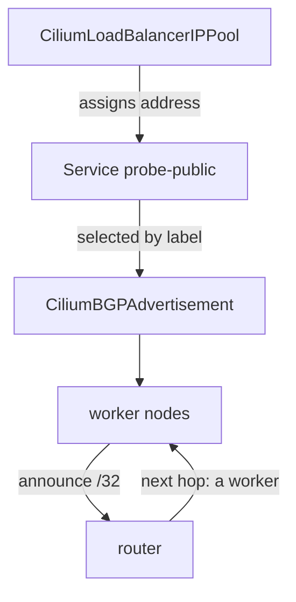

# Load Balancer Addresses From A Pool

A Service of type `LoadBalancer` asks the environment for an external address. Cloud providers answer that request with a cloud load balancer. A cluster without a cloud provider has nobody to answer, and the Service waits forever. Cilium can answer the request itself with load balancer IP address management (LB IPAM), and BGP can then make the address reachable. This part shows both steps.

## The problem a pool solves

When you create a Service of type `LoadBalancer` in a bare `kind` cluster, its `EXTERNAL-IP` column shows `<pending>`. Kubernetes has no component that assigns an address. Cilium LB IPAM is that component: the Cilium operator takes an address from a pool that you define and writes it into the status of the Service.

An address from a pool is not yet reachable. The pool only assigns an address. The router must also learn where the address lives, and BGP does that. Each step has its own resource, and each can fail on its own.

## The pool resource

A `CiliumLoadBalancerIPPool` lists address blocks. The playground defines one pool, named `starfleet-pool`, with the block `198.51.100.0/28`. This block is a documentation range (it is reserved for examples and does not belong to any real network), which is safe in a test cluster. Check the pool and the state of a Service:

<!-- astrona:playground:renew -->

```sh
kubectl get ciliumloadbalancerippools
kubectl -n starfleet get service probe
```

The first command shows the pool with its block and the number of available addresses. The Service `probe` is of type `ClusterIP`, so it has no external address yet.

A pool has these fields.

- `blocks`: the address ranges, each as a `cidr` or as a `start` and `stop` pair.
- `serviceSelector`: which Services may use the pool. Without a selector, every Service of type `LoadBalancer` can use it.
- `allowFirstLastIPs`: whether the first and last address of a block may be used. The default for CIDR blocks leaves them out.
- `disabled`: stops the pool from assigning addresses.

A cluster can have several pools. The operator picks an address from the pools whose selector matches the Service. A Service can also ask for a specific address with the annotation `lbipam.cilium.io/ips`. The address must come from a pool that matches the Service.

## Create a Service that gets an address

Save this as `service-probe-public.yaml`. It is a second Service for the same pods, of type `LoadBalancer`, with the label that the Service advertisement from the previous part selects:

```yaml
apiVersion: v1
kind: Service
metadata:
  name: probe-public
  namespace: starfleet
  labels:
    bgp: advertise
spec:
  type: LoadBalancer
  selector:
    app: probe
  ports:
  - port: 80
    targetPort: 8080
```

Apply it:

```sh
kubectl apply -f service-probe-public.yaml
```

Then check the result. The operator assigns the address within a moment:

```sh
kubectl -n starfleet get service probe-public
```

The `EXTERNAL-IP` column shows an address from `198.51.100.0/28`. If it shows `<pending>`, no pool matches the Service, or the pool is exhausted. Read `kubectl describe service probe-public -n starfleet` and the conditions of the pool.

## Make the address reachable

The Service advertisement of the previous part is selected by the label `advertise: bgp`, and it selects Services with the label `bgp=advertise`. Both conditions are now true, so the speakers announce the address. Check on the router:

```sh
ROUTER_CONTAINER=$(kubectl -n starfleet get configmap lab-env -o jsonpath='{.data.ROUTER_CONTAINER}')
docker exec $ROUTER_CONTAINER vtysh -c 'show ip route bgp'
```

The router lists the Service address as a `/32` route. The next hop is the address of a worker node. A packet from the router to the Service address arrives on that node, and the Cilium agent forwards it to a pod that backs the Service.



The diagram shows the order: the pool assigns the address, the advertisement selects the Service, the workers announce it, and the router sends traffic to a worker.

## Which node receives the traffic

Every worker that runs a speaker announces the Service address, so the router has one route per worker. How it uses them depends on the router. A router with multipath turned on spreads connections over both workers. A router without it picks one.

The field `externalTrafficPolicy` of the Service changes who announces. With `Cluster`, which is the default, every node announces the address, and a node forwards a connection to a pod on any node. With `Local`, a node announces the address only when it runs a pod that backs the Service. This keeps the real client address and avoids a second hop, but a node without a local pod does not receive traffic. Cilium withdraws the announcement of a node that has no local backend.

## What you can now do

You can explain why a Service of type `LoadBalancer` stays pending without a pool, define a pool and select Services with it, create a Service that receives an address, and trace the address from the pool to a route on the router. You can also state what `externalTrafficPolicy` does to the announcements.

## Common pitfalls

> [!WARNING]
> An address from a pool is not reachable until a BGP advertisement announces it. A Service without the label that the advertisement selects gets an address but no route. A pool with a `serviceSelector` that does not match leaves the Service pending. With `externalTrafficPolicy: Local`, a node without a backend does not announce the address, so a missing route on one worker can be correct.
